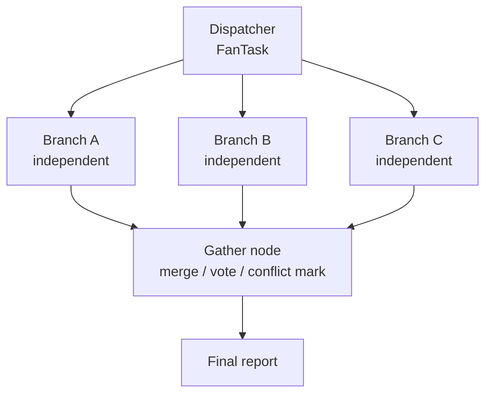

# Fan-out / Fan-in Parallel Aggregation Framework


## Overview

Fan-out / fan-in, also called scatter-gather, is simple: one dispatcher copies a task to several branches that never talk to each other, the branches run at the same time, and a gather node merges whatever comes back.

This repo is a runnable version of that idea. The core is plain `asyncio`; timeout, retry, degradation and long-tail stats are written out in the code instead of hidden behind a framework. A LangGraph implementation of the same branches and aggregators is included so you can compare the two.

Branch count and roles are fixed at construction time. Branches never see each other's intermediate output, which is what separates this from a roundtable setup.



Every branch is wrapped in `asyncio.wait_for` plus a retry loop. When the global deadline is reached, unfinished branches are cancelled and recorded as degraded, so the gather node always fires. Aggregation receives the full result list, failures included.

## Requirements

| Package | Purpose | Required |
|---|---|---|
| Python 3.11+ | Runtime | Yes |
| `openai` | OpenAI-compatible API calls | Yes (offline mode never calls it) |
| `langgraph` | Graph orchestration example | Optional |
| `pytest` | Test suite | Optional |

## Project Structure

```
.
├── main.py                     # CLI entry and three demo scenarios
├── fanout/
│   ├── __init__.py             # Public exports
│   ├── core.py                 # Task, result, report and interfaces
│   ├── executor.py             # Scheduling, timeout, retry, degradation
│   ├── llm.py                  # Offline mock and OpenAI-compatible client
│   ├── agents.py               # Review, solution and voting agents
│   ├── aggregators.py          # Merge, conflict, score and vote strategies
│   ├── pipeline.py             # Dispatch -> parallel -> gather
│   └── langgraph_adapter.py    # Optional LangGraph implementation
├── tests/test_fanout.py        # Behavior tests, no network
├── requirements.txt
└── .gitignore
```

## Usage

```bash
pip install -r requirements.txt
```

Run everything offline:

```bash
python main.py
```

Run one scenario:

```bash
python main.py review
python main.py solutions
python main.py vote
python main.py graph
```

Use a real endpoint:

```bash
# bash
export FANOUT_API_KEY="your-key"
export FANOUT_BASE_URL="https://api.deepseek.com/v1"
export FANOUT_MODEL="deepseek-chat"
python main.py all --real
```

```powershell
# PowerShell
$env:FANOUT_API_KEY="your-key"
$env:FANOUT_BASE_URL="https://api.deepseek.com/v1"
$env:FANOUT_MODEL="deepseek-chat"
python main.py all --real
```

| Flag | Default | Description |
|---|---|---|
| `--real` | off | Use the real API instead of the offline mock |
| `--model` | `FANOUT_MODEL` or `gpt-4o-mini` | Model name |
| `--timeout` | `30` | Per-branch timeout in seconds |
| `--retries` | `1` | Retry count after a branch failure |

Tests:

```bash
python -m pytest tests -q
```

## Aggregation Strategies

| Strategy | Use case | Behavior |
|---|---|---|
| `MergeAggregator` | Plain summaries | Joins successful branch text, drops duplicate lines |
| `ConflictMarkAggregator` | Multi-expert review | Groups findings by topic; differing stances become conflicts with evidence |
| `ScoreAggregator` | Multi-plan generation | Ranks by self-score; suggests merging when the top two are close |
| `VoteAggregator` | Multi-model voting | Needs a strict majority; ties and split votes are reported as conflicts |

When stances or votes disagree, the report keeps each side's reasoning. It does not flatten them into one answer.

## Offline Mode

The mock returns fixed answers keyed by role and label, and sleeps briefly to mimic branch latency. The security review branch is deliberately slower, so the review demo prints a long-tail warning. Nothing touches the network.

## LangGraph Adapter

`fanout/langgraph_adapter.py` puts the same agents into a `StateGraph`: each branch is a node starting from `START`, results are merged with `operator.add`, and a `gather` node runs after all branches finish. Per-branch timeout and retry are imported from the native executor, so both versions behave the same way.

## Notes

- Wall-clock time is set by the slowest branch. Add enough slow branches and the parallel win disappears.
- More branches means more cost and more chances of failure. Keeping roles orthogonal matters more than adding reviewers.
- Retries apply to timeouts as well. If an upstream stays slow, cut `--retries` and let degradation handle it.
- This pattern is a building block, not a collaboration model. Tasks that need agents to debate and revise each other belong in a roundtable topology.

## Contributing

Open an issue or send a PR. Keep changes small. If you add an aggregation strategy, cover it in `tests/test_fanout.py` and keep the branch interface free of cross-branch communication.

## Contact

Ailan Anjuxi (谙弆悕博士)
📫 Email: anjuxi.ME@outlook.com
📞 SIP: sip:anjuxi@sip.linphone.org

> © 2026 谙弆悕博士（Ailan Anjuxi），All rights reserved.
