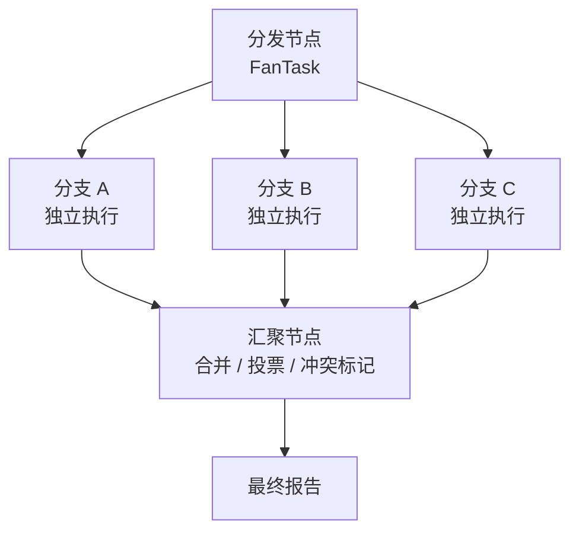

# 扇入扇出并行汇聚架构


## 项目介绍

Fan-out / Fan-in 也叫散射汇聚，做法不复杂：一个分发节点把任务复制成几份，交给互不通信的分支同时执行，最后汇到一处合并、投票或者标记冲突。

这个仓库是照这个思路写的可运行版本。核心只用 `asyncio`，超时、重试、降级和长尾统计都直接写在代码里，没有藏进框架。另附一份 LangGraph 实现，分支和汇聚策略跟原生版本共用，方便对照。

分支数量和角色在构造时定下来，运行时不改拓扑。分支之间拿不到彼此的中间结果，这也是它和圆桌协商最主要的区别。



执行器给每条分支套了 `asyncio.wait_for` 和重试循环。到了全局期限还没结束的分支会被取消并记为降级，汇聚节点一定会触发，不会因为一条分支卡住就停摆。

## 依赖说明

| 依赖 | 用途 | 是否必需 |
|---|---|---|
| Python 3.11+ | 运行环境 | 必需 |
| `openai` | 调用 OpenAI 兼容接口 | 必需（离线模式不会真正请求） |
| `langgraph` | 图编排对照示例 | 可选 |
| `pytest` | 运行测试 | 可选 |

## 项目结构

```
.
├── main.py                     # 命令行入口与三个演示场景
├── fanout/
│   ├── __init__.py             # 对外导出
│   ├── core.py                 # 任务、结果、报告与抽象接口
│   ├── executor.py             # 并行调度、超时、重试、降级
│   ├── llm.py                  # 离线 mock 与 OpenAI 兼容客户端
│   ├── agents.py               # 评审、方案、投票三类分支 Agent
│   ├── aggregators.py          # 合并、冲突、评分、投票四种汇聚策略
│   ├── pipeline.py             # 分发 -> 并行 -> 汇聚流水线
│   └── langgraph_adapter.py    # 可选的 LangGraph 并行边实现
├── tests/test_fanout.py        # 行为测试，不依赖网络
├── requirements.txt
└── .gitignore
```

## 使用说明

安装依赖：

```bash
pip install -r requirements.txt
```

默认离线运行全部场景：

```bash
python main.py
```

单独跑某个场景：

```bash
python main.py review      # 多专家并行评审
python main.py solutions   # 多方案并行生成
python main.py vote        # 多模型投票
python main.py graph       # LangGraph 并行边对照
```

接真实模型：

```bash
# bash
export FANOUT_API_KEY="你的密钥"
export FANOUT_BASE_URL="https://api.deepseek.com/v1"
export FANOUT_MODEL="deepseek-chat"
python main.py all --real
```

```powershell
# PowerShell
$env:FANOUT_API_KEY="你的密钥"
$env:FANOUT_BASE_URL="https://api.deepseek.com/v1"
$env:FANOUT_MODEL="deepseek-chat"
python main.py all --real
```

| 参数 | 默认值 | 说明 |
|---|---|---|
| `--real` | 关闭 | 使用真实接口，而不是离线 mock |
| `--model` | `FANOUT_MODEL` 或 `gpt-4o-mini` | 模型名称 |
| `--timeout` | `30` | 单条分支超时秒数 |
| `--retries` | `1` | 分支失败后的重试次数 |

跑测试：

```bash
python -m pytest tests -q
```

## 汇聚策略

| 策略 | 适用场景 | 行为 |
|---|---|---|
| `MergeAggregator` | 普通汇总 | 拼接成功分支的文本，整行去重 |
| `ConflictMarkAggregator` | 多专家评审 | 按议题归并立场，不一样的标成冲突并附依据 |
| `ScoreAggregator` | 多方案生成 | 按自评分排序，前两名分差很小时提示融合 |
| `VoteAggregator` | 多模型投票 | 严格过半才算结论，平票和票型分散都记为冲突 |

立场或票型对不上时，报告里保留各自的理由，不会硬合成一个答案。

## 离线模式

离线 mock 按角色返回固定答案，顺带 sleep 一小段模拟耗时。安全评审那条故意慢一些，跑 `review` 场景能看到长尾提示。整个过程不联网。

## 几个坑

- 整体耗时看最慢的分支。慢分支一多，并行省下来的时间会被吃掉。
- 分支越多，调用成本和失败概率越高。相比堆数量，把职责分清楚更有用。
- 重试对超时也生效。上游一直慢就减少重试次数，交给降级处理。
- 需要互相辩论、反复改稿的任务不适合这个模式，换圆桌更合适。

## 贡献指南

有问题直接提 Issue，改动尽量小。新增汇聚策略的话，在 `tests/test_fanout.py` 补上对应测试，分支接口不要引入跨分支通信。

## 联系作者

谙弆悕博士（Ailan Anjuxi）
📫 邮箱：anjuxi.ME@outlook.com
📞 SIP 电话：sip:anjuxi@sip.linphone.org

> © 2026 谙弆悕博士（Ailan Anjuxi），All rights reserved.
